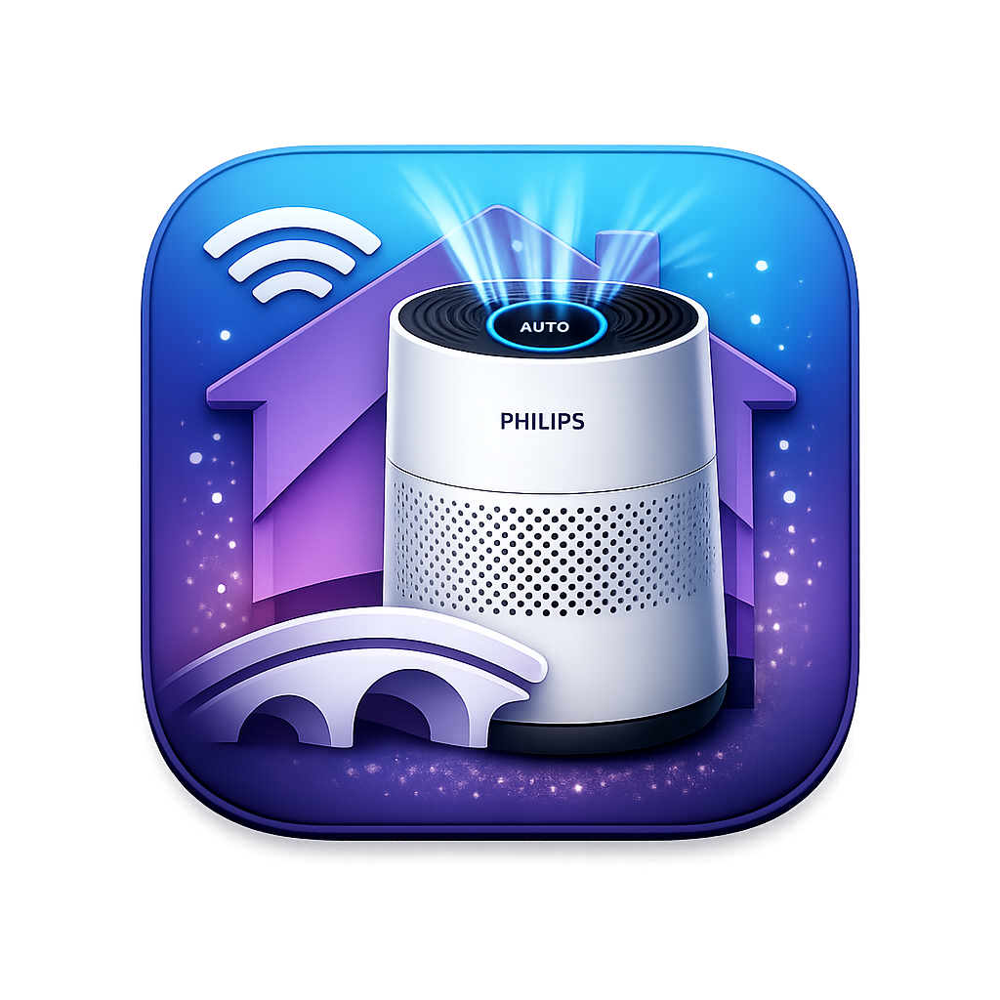

# homebridge-philips-air-purifier-complete

<p align="center">
  
</p>

<p align="center">
  <a href="https://www.npmjs.com/package/homebridge-philips-air-purifier-complete"></a>
  <a href="https://homebridge.io"></a>
  <a href="LICENSE"></a>
</p>

Control your Philips Air Purifier from Apple HomeKit via Homebridge — **no install scripts, no pip, no virtual environment**.

Everything the plugin needs ships inside the npm package: the [aioairctrl](https://github.com/betaboon/aioairctrl) CoAP library, its Python dependencies, and a pure-Python AES implementation. The only requirement is Python 3.11 or newer, which most Linux-based Homebridge hosts already have.

---

For security reporting and known protocol limitations, see [SECURITY.md](SECURITY.md).

## Features

- **Power On/Off** — Turn your air purifier on or off
- **4 Fan Modes** — Auto, Sleep, Medium, Turbo (via rotation speed slider)
- **Sleep Mode Switch** — Dedicated HomeKit switch that sets Sleep mode and dims the display
- **Air Quality Sensor** — Real-time PM2.5 readings with derived AQI rating
- **Display Light Control** — Toggle and 3-level brightness (Off / Dim / Bright)
- **Child Lock** — Lock or unlock physical controls on the device
- **HEPA Filter Status** — Filter life percentage and change alert
- **Pre-Filter Status** — Cleanup cycle percentage and change alert
- **HTTP Protocol Support** — Supports AC1xxx-series DH/AES HTTP models (e.g. AC1715) and HomeID/Condor local HTTP devices
- **Real-time Updates** — CoAP Observe push updates (AC2xxx+) or 10-second HTTP polling (HTTP/HomeID)
- **Auto-reconnect** — Daemon restarts automatically with exponential backoff if the device drops off

### Compared with other Philips plugins

| | This plugin | [`@atdr/homebridge-philipsair-platform`](https://github.com/atdr/homebridge-philipsair-platform) | [`homebridge-philips-airplus-cloud`](https://www.npmjs.com/package/homebridge-philips-airplus-cloud) |
|---|---|---|---|
| Local CoAP (AC2xxx+) | Yes | Yes | No |
| Local HTTP DH/AES (older AC1xxx/AC2xxx firmware) | Yes | No | No |
| HomeID / PhilipsCondor local HTTP(S) | Yes | No | No |
| Air+ cloud (AC0650, AC1715) | Yes | No | Yes |
| Mixed protocols in one platform | Yes | — | — |
| Python packages you install yourself | None (bundled) | `aioairctrl` via pip/pipx | None |

The other plugins cover things this one doesn't, such as humidifier models and wider per-model
mappings in `@atdr/homebridge-philipsair-platform`. Pick the one that fits your devices.

---

## Prerequisites

| Requirement | Version |
|-------------|---------|
| [Homebridge](https://homebridge.io) | >= 2.0.0 |
| Node.js | 22, 24 or 26 |
| Python 3 | >= 3.11 (standard library only) |
| Your Philips Air Purifier's **IP address** | — |

The plugin installs no Python packages. `aiocoap` and `paho-mqtt` are bundled in `vendor/`
(pinned in `requirements.txt`) and AES is implemented in pure Python, so any Python 3.11+
works as it is.

Most Homebridge hosts already have a suitable Python. If yours doesn't:

```bash
# macOS (the built-in python3 is too old)
brew install python
```

```bash
# Debian, Ubuntu, Raspberry Pi OS
sudo apt install python3
```

On Windows, install Python from [python.org](https://www.python.org/downloads/).

---

## Installation

### Via Homebridge UI (recommended)

1. Open the Homebridge UI
2. Go to **Plugins**
3. Search for `homebridge-philips-air-purifier-complete`
4. Click **Install**, then open **Plugin Settings**

The **Environment** panel at the top of Plugin Settings shows which Python was found and, if
none was, the exact command to fix it. Python is auto-detected. If yours is somewhere unusual
(Docker, NAS), set **Python Path** on the device to its absolute path, or set the
`PHILIPS_AIR_PYTHON` environment variable for Homebridge.

If no usable Python is found, the plugin logs one error saying what it found and why it can't use
it (for example "Python 3.10.12, older than 3.11"), with the fix. Its accessories show as **Not
Responding**, and it doesn't retry until Homebridge restarts. The panel runs in the settings UI
process; Homebridge normally sees the same Python unless it runs with a different `PATH`.

### Via npm

```bash
npm install -g homebridge-philips-air-purifier-complete
```

No install step runs. Upgrading from v4.x leaves nothing behind, because the old `.venv` lived
inside the plugin folder and npm replaces that folder.

---

## Migrating from v2.x to v3.0.0

v3.0.0 changes the plugin type from `accessory` to `platform`. Update your Homebridge
`config.json` before restarting Homebridge.

1. Move device entries from `"accessories"` into `"platforms"[0]."devices"`:

   **Before: v2.x accessory config**

   ```json
   {
     "accessories": [
       {
         "name": "Air Purifier",
         "host": "192.168.1.17",
         "accessory": "PhilipsAirPurifier"
       }
     ]
   }
   ```

   **After: v3.x platform config**

   ```json
   {
     "platforms": [
       {
         "platform": "PhilipsAirPurifier",
         "name": "Philips Air Purifiers",
         "devices": [
           {
             "name": "Air Purifier",
             "host": "192.168.1.17"
           }
         ]
       }
     ]
   }
   ```

2. Remove the `"accessory": "PhilipsAirPurifier"` key from each device entry.

3. Restart Homebridge.

From v5.0.0 the plugin no longer registers an accessory at all (it was already disabled by
default from v3.2.3), and the `PHILIPS_AIR_ALLOW_LEGACY_ACCESSORY` rollback has been removed.
If Homebridge logs `No plugin was found for the accessory "PhilipsAirPurifier"`, an old entry is
still in the top-level `"accessories"` array of `config.json`, even if this plugin's settings
only show `{ "platform": "PhilipsAirPurifier" }`. Homebridge keeps running. Delete that old
object and keep the device under `"platforms"[]."devices"`.

### Migration examples

#### CoAP device

**Before:**

```json
{
  "accessories": [
    {
      "accessory": "PhilipsAirPurifier",
      "name": "Bedroom",
      "host": "192.168.1.100"
    }
  ]
}
```

**After:**

```json
{
  "platforms": [
    {
      "platform": "PhilipsAirPurifier",
      "name": "Philips Air Purifiers",
      "devices": [
        {
          "name": "Bedroom",
          "host": "192.168.1.100"
        }
      ]
    }
  ]
}
```

#### HTTP or HomeID device

**Before:**

```json
{
  "accessories": [
    {
      "accessory": "PhilipsAirPurifier",
      "name": "Study",
      "host": "192.168.1.102",
      "protocol": "homeid-http",
      "useHttps": true,
      "clientId": "BASE64_CLIENT_ID",
      "clientSecret": "BASE64_CLIENT_SECRET"
    }
  ]
}
```

**After:**

```json
{
  "platforms": [
    {
      "platform": "PhilipsAirPurifier",
      "name": "Philips Air Purifiers",
      "devices": [
        {
          "name": "Study",
          "host": "192.168.1.102",
          "protocol": "homeid-http",
          "useHttps": true,
          "clientId": "BASE64_CLIENT_ID",
          "clientSecret": "BASE64_CLIENT_SECRET"
        }
      ]
    }
  ]
}
```

#### Air+ cloud device

**Before:**

```json
{
  "accessories": [
    {
      "accessory": "PhilipsAirPurifier",
      "name": "Air Purifier (Air+)",
      "host": "cloud",
      "protocol": "airplus-cloud",
      "airplusDeviceUuid": "AIRPLUS_DEVICE_UUID",
      "airplusTokenFile": "/home/homebridge/.homebridge/philips-airplus-AIRPLUS_DEVICE_UUID.json"
    }
  ]
}
```

**After:**

```json
{
  "platforms": [
    {
      "platform": "PhilipsAirPurifier",
      "name": "Philips Air Purifiers",
      "devices": [
        {
          "name": "Air Purifier (Air+)",
          "host": "cloud",
          "protocol": "airplus-cloud",
          "airplusDeviceUuid": "AIRPLUS_DEVICE_UUID",
          "airplusTokenFile": "/home/homebridge/.homebridge/philips-airplus-AIRPLUS_DEVICE_UUID.json"
        }
      ]
    }
  ]
}
```

**Note:** HomeKit will treat migrated devices as new accessories. Re-add them to rooms,
scenes, and automations in the Home app.

---

## Configuration

Add to your Homebridge `config.json` under `"platforms"`:

```json
{
  "platforms": [
    {
      "platform": "PhilipsAirPurifier",
      "name": "Philips Air Purifiers",
      "devices": [
        {
          "name": "Living Room Air Purifier",
          "host": "192.168.1.100"
        }
      ]
    }
  ]
}
```

For AC1xxx models that use HTTP:

```json
{
  "platforms": [
    {
      "platform": "PhilipsAirPurifier",
      "name": "Philips Air Purifiers",
      "devices": [
        {
          "name": "Bedroom Air Purifier",
          "host": "192.168.1.101",
          "protocol": "http"
        }
      ]
    }
  ]
}
```

For HomeID/Condor local HTTP devices:

```json
{
  "platforms": [
    {
      "platform": "PhilipsAirPurifier",
      "name": "Philips Air Purifiers",
      "devices": [
        {
          "name": "Study Air Purifier",
          "host": "192.168.1.102",
          "protocol": "homeid-http",
          "useHttps": true,
          "clientId": "BASE64_CLIENT_ID",
          "clientSecret": "BASE64_CLIENT_SECRET"
        }
      ]
    }
  ]
}
```

Use the Homebridge plugin configuration form to add, edit, or remove CoAP, HTTP, HomeID, and
Air+ cloud devices. The form presents `devices[]` as one tab per purifier, with protocol-specific
fields shown only when they apply.

Air+ cloud devices also need an account token. Open **Plugin Settings**, enter the Philips account
email, complete the verification code flow, select the device, then review the new Air+ card and
click **Save Changes**.

The **JSON Config** tab remains supported for direct edits to `devices[]`. Existing v3.1
installations that still contain `additionalDevicesJson` continue to merge those entries at
runtime for backwards compatibility, but that field is no longer shown in the GUI.

### Configuration Options

| Option | Required | Default | Description |
|--------|----------|---------|-------------|
| `platform` | Yes | — | Must be `PhilipsAirPurifier` in the platform entry. |
| `name` | No | `Philips Air Purifiers` | Platform name for the Homebridge UI. |
| `devices` | Yes | `[]` | Array of purifier device entries. |
| `devices[].name` | Yes | — | Name shown in HomeKit. |
| `devices[].host` | Yes, except Air+ | — | IPv4 address of your purifier. Use `cloud` for `airplus-cloud`. |
| `devices[].protocol` | No | `coap` | Communication protocol. Use `http` for AC1xxx DH/AES models, `homeid-http` for HomeID/Condor local HTTP devices, or `airplus-cloud` for Philips Air+ cloud devices. |
| `devices[].useHttps` | No | `false` | Use HTTPS for `homeid-http` devices with self-signed certificates. Ignored for `coap` and `http`. |
| `devices[].clientId` | No | — | Base64 HomeID local API client ID for PhilipsCondor challenge authentication. |
| `devices[].clientSecret` | No | — | Base64 HomeID local API client secret for PhilipsCondor challenge authentication. |
| `devices[].encryptionKey` | No | Auto-fetched when possible | Optional hex AES key for HomeID encrypted payloads. Leave blank unless you already know it. |
| `devices[].airplusDeviceUuid` | Yes for Air+ | — | Philips Air+ device UUID. Filled automatically by the setup wizard. |
| `devices[].airplusTokenFile` | No | `<Homebridge storage>/philips-airplus-{uuid}.json` (falls back to an existing `~/.homebridge/philips-airplus-{uuid}.json`) | Token file written by the setup wizard or CLI setup script. |
| `devices[].pythonPath` | No | Auto-detected | Path or command name for Python 3.11 or newer (for example `/usr/local/bin/python3.12` or `python3.12`). No packages are needed. Leave blank to auto-detect; the Environment panel in Plugin Settings shows what was found. |
| `additionalDevicesJson` | No | — | Legacy v3.1 runtime fallback. Additional entries are still merged with `devices[]`, but this field is no longer shown in the GUI. |

### Model Compatibility

| Protocol | Models | Notes |
|----------|--------|-------|
| `coap` (default) | AC2xxx, AC3xxx, AC4xxx | CoAP Observe push updates |
| `http` | AC1xxx DH/AES models (e.g. AC1715) | HTTP polling every 10 seconds via `/air` |
| `homeid-http` | HomeID/Condor local HTTP devices | HTTP/HTTPS polling every 10 seconds via `/status`, `/air`, and `/fltsts` |
| `airplus-cloud` | Devices registered in the Philips Air+ app | Cloud MQTT updates via the Air+ account token |

If your device shows `Network error: NetworkError` on every command, try setting `"protocol": "http"` in that device entry.

---

## Air+ Cloud Setup (AC0650, AC1715)

> **Breaking change for existing Air+ users:** After upgrading to 4.0.0, run setup once more for
> each purifier before restarting Homebridge — either the Homebridge UI wizard below or
> `scripts/airplus_setup.py`. Existing token files do not contain the required `id_token`.
>
> On 4.0.0 the UI wizard could not complete the login and wrote token files without the
> `id_token`. Use 4.0.1 or newer if you are setting up from the Homebridge UI.

### Quick Setup (Homebridge UI — recommended)

1. Install the plugin via the Homebridge UI
2. Go to **Plugins → Philips Air Purifier → Plugin Settings**
3. Enter the email address for your Philips Air+ account
4. Click **Send Code**
5. Enter the verification code from the email and click **Verify & List Devices**
6. Click **Add Device** next to your purifier
7. Review the new Air+ device card and click **Save Changes**
8. Restart Homebridge

Each device needs its own setup run. Run through the wizard once per purifier.

The older browser redirect-copy login remains available under
**Advanced: log in via browser**. Use it only as a fallback; the email verification code flow avoids
the desktop deep-link mismatch that can produce `invalid_grant` errors.

> **Apple Private Relay note:** A `*@privaterelay.appleid.com` address may never
> receive the verification code (Apple does not forward mail from unregistered
> senders to Sign-in-with-Apple relay addresses). If **Send Code** appears to
> work but no email arrives, use your real Philips account email or the
> **Advanced: log in via browser** fallback. See Troubleshooting.

Deleting an Air+ device from the Homebridge form removes it from the Homebridge config only. The
token file is intentionally left on disk at `~/.homebridge/philips-airplus-{uuid}.json` so an
accidental delete does not revoke local setup state. Remove that file manually if you are cleaning
up an Air+ device permanently.

### Advanced / Headless Setup (SSH)

If your Homebridge host has no browser access (Docker, NAS, headless Raspberry Pi):

```bash
cd /path/to/homebridge-philips-air-purifier-complete
python3 scripts/airplus_setup.py
```

Follow the on-screen instructions. The script sends an email verification code, saves a token file to
`~/.homebridge/philips-airplus-{uuid}.json` and prints the Homebridge config to add.

To use the legacy browser redirect-copy fallback instead:

```bash
python3 scripts/airplus_setup.py --browser
```

---

## Connectivity Check (optional)

Before configuring Homebridge, you can verify the plugin can reach your device:

```bash
# Run a sensor query (any Python 3.11+, nothing to activate)
python3 $(npm root -g)/homebridge-philips-air-purifier-complete/philips_air_api.py 192.168.1.100 sensors

# Probe HomeID local HTTP endpoints without changing device state
python3 $(npm root -g)/homebridge-philips-air-purifier-complete/philips_air_api.py 192.168.1.100 probe-homeid
python3 $(npm root -g)/homebridge-philips-air-purifier-complete/philips_air_api.py 192.168.1.100 probe-homeid --use-https
```

You should see a JSON payload with PM2.5, filter life, temperature, and so on. CoAP can be flaky on the first connection — re-run if you get a timeout.

---

## HomeKit Tiles

Once configured, your air purifier appears in the Apple Home app with:

| Tile | What It Controls |
|------|-----------------|
| Air Purifier | Power, Auto/Manual mode, fan speed (Sleep / Medium / Turbo) |
| Sleep Mode | Switch that activates Sleep mode and dims the display |
| Air Quality | PM2.5 density and derived AQI rating |
| Display Light | On/off toggle and 3-level brightness |
| Child Lock | Lock/unlock physical controls on the device |
| HEPA Filter | Remaining filter life percentage, change alert below 10% |
| Pre-Filter | Cleanup cycle status, change alert below 10% |

---

## Architecture

```
Homebridge (Node.js)
    │
    │  stdin/stdout JSON
    │
    ▼
philips_air_api.py  ─── aioairctrl/ ──► aiocoap (vendor/) ──► Philips device (CoAP)
    │
    ├──────────────────── DH/AES HTTP polling ──────────────► Philips device (HTTP)
    │
    └──────────────────── HomeID HTTP/HTTPS polling ────────► Philips device (HomeID)
    │
    │  CoAP Observe (push)
    │  ≈ every 30s or on change
    │  HTTP polling every 10s
    ▼
State cache ──► HomeKit characteristics
```

- The Python daemon maintains a **CoAP Observe** subscription to the device
- For HTTP models, the Python daemon polls the local API every 10 seconds
- HomeID mode polls `status`, `air`, and `fltsts`, and supports PhilipsCondor challenge authentication
- Commands (power, mode, light) are sent directly and complete in ~100–300ms
- The Node.js plugin communicates with the daemon over stdin/stdout JSON
- If the daemon exits for any reason, Homebridge restarts it with exponential backoff (5s → 10s → 30s → 60s)

---

## CLI Tool

The bundled Python script can be used standalone for diagnostics:

```bash
python3 philips_air_api.py 192.168.1.100 sensors
python3 philips_air_api.py 192.168.1.100 status
python3 philips_air_api.py 192.168.1.100 power on
python3 philips_air_api.py 192.168.1.100 power off
python3 philips_air_api.py 192.168.1.100 mode auto
python3 philips_air_api.py 192.168.1.100 mode sleep
python3 philips_air_api.py 192.168.1.100 mode medium
python3 philips_air_api.py 192.168.1.100 mode turbo
python3 philips_air_api.py 192.168.1.100 light 0      # off
python3 philips_air_api.py 192.168.1.100 light 115    # dim
python3 philips_air_api.py 192.168.1.100 light 123    # bright
python3 philips_air_api.py 192.168.1.100 childlock on
python3 philips_air_api.py 192.168.1.100 childlock off
```

---

## Troubleshooting

**Plugin loads but device is "No Response" in HomeKit**
- Verify the IP address is correct and the device is on the same network
- Run the connectivity check above
- Check Homebridge logs for daemon error messages

**Log says `Python 3.11+ was not found`**
- Open **Plugin Settings**. The **Environment** panel shows what was checked and the fix for your OS
- Install Python 3.11+ (see [Prerequisites](#prerequisites)), then restart Homebridge
- If Python is installed somewhere the plugin doesn't look, set **Python Path** on the device (an
  absolute path such as `/usr/local/bin/python3.12`) or the `PHILIPS_AIR_PYTHON` environment variable

**Persistent CoAP timeouts**
- CoAP (UDP) can be blocked by some network configurations; ensure UDP is allowed between Homebridge and the device
- Assign a static IP to the device in your router's DHCP settings

**`Network error: NetworkError` on every command**
- Your device may use HTTP instead of CoAP. Set `"protocol": "http"` for AC1xxx DH/AES models such as AC1715.
- If your device responds to HomeID local HTTP endpoints or PhilipsCondor authentication challenges, use `"protocol": "homeid-http"` and configure `clientId` / `clientSecret` if required.

**Air+ verification code email never arrives (Apple Private Relay)**
- If you use an Apple Private Relay / "Hide My Email" address (`*@privaterelay.appleid.com`), the code email may be silently dropped. Apple only forwards mail to a *Sign in with Apple* relay address from sender domains Philips has registered with Apple; Philips' OTP sender is not guaranteed to be registered, so the email bounces before it reaches you.
- Workarounds: (a) use the real email address behind your Philips account instead of the relay address; (b) check whether a standalone iCloud+ "Hide My Email" alias (which forwards from any sender) receives the code; or (c) use the **Advanced: log in via browser** fallback flow.
- This is an Apple/Philips delivery limitation — the plugin passes your email straight to Philips and cannot change how the code is sent.

---

## Versioning

This project follows [Semantic Versioning](https://semver.org/). See [CHANGELOG.md](CHANGELOG.md) for the full history.

---

## License

MIT — see [LICENSE](LICENSE).

---

## Credits and Attribution

This project is a combined and enhanced fork of two open-source projects:

| Project | Author | Licence |
|---------|--------|---------|
| [louiscrc/homebridge-philips-air-purifier](https://github.com/louiscrc/homebridge-philips-air-purifier) | [louiscrc](https://github.com/louiscrc) | MIT |
| [betaboon/aioairctrl](https://github.com/betaboon/aioairctrl) | [betaboon](https://github.com/betaboon) | MIT |

See [CONTRIBUTORS.md](CONTRIBUTORS.md) for the full contributor list.

---

## Support

- **Issues:** [GitHub Issues](https://github.com/MaddogWarner/homebridge-philips-air-purifier-complete/issues)
- **Homebridge community:** [homebridge.io](https://homebridge.io)
